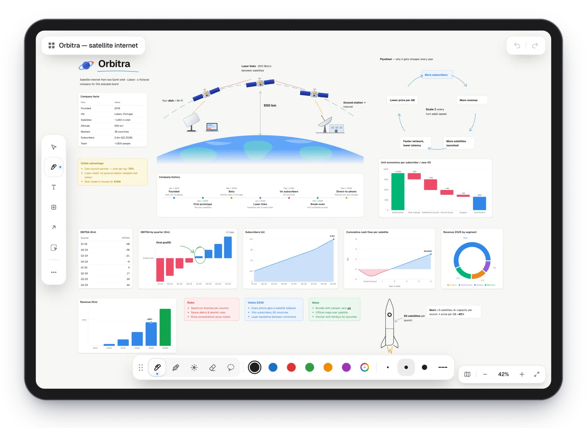
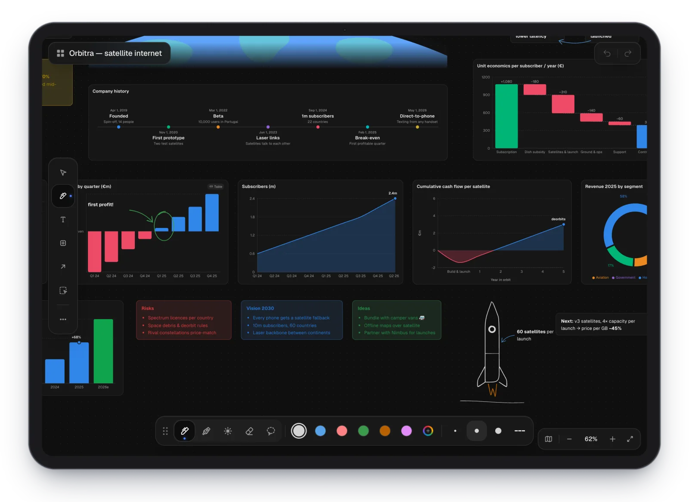
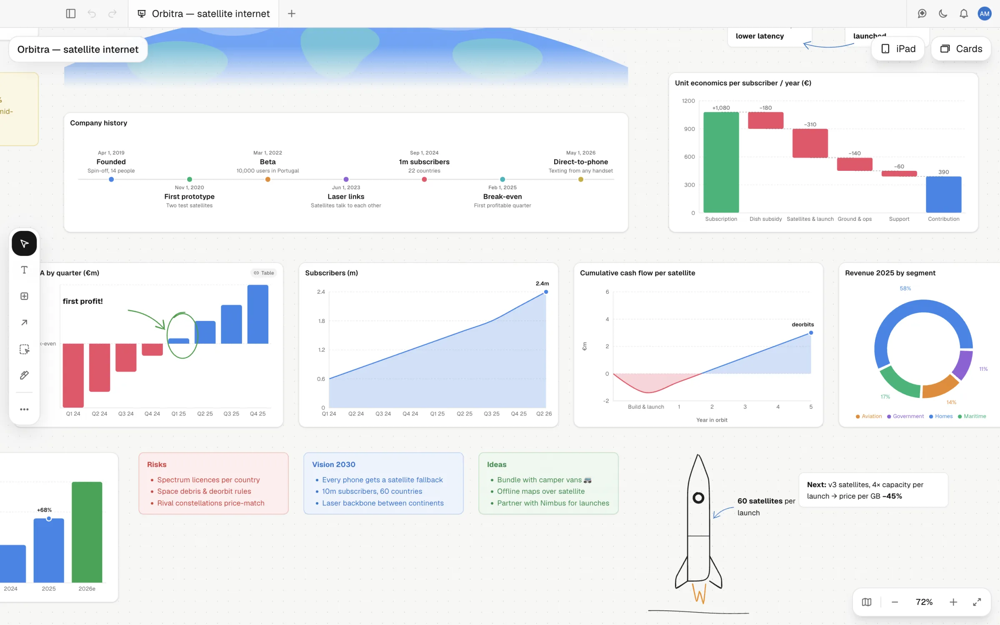
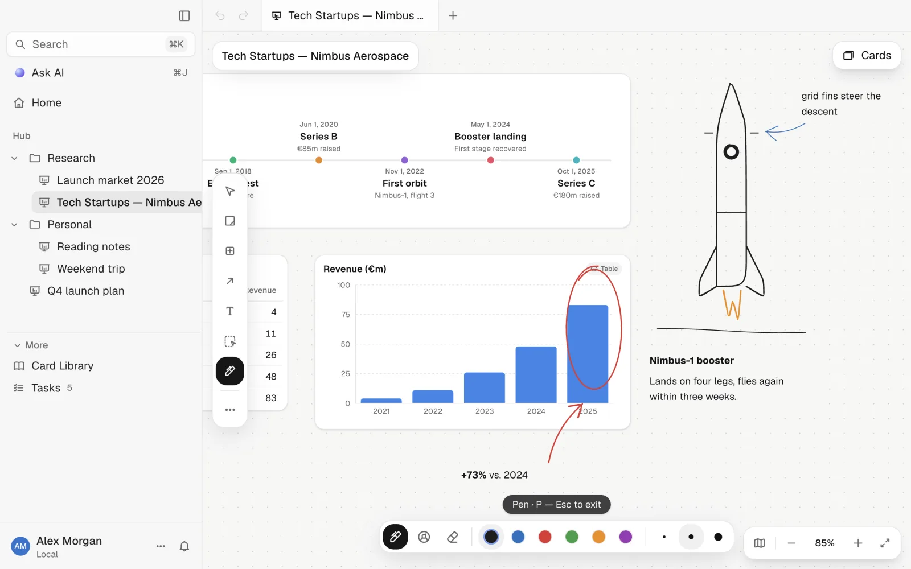
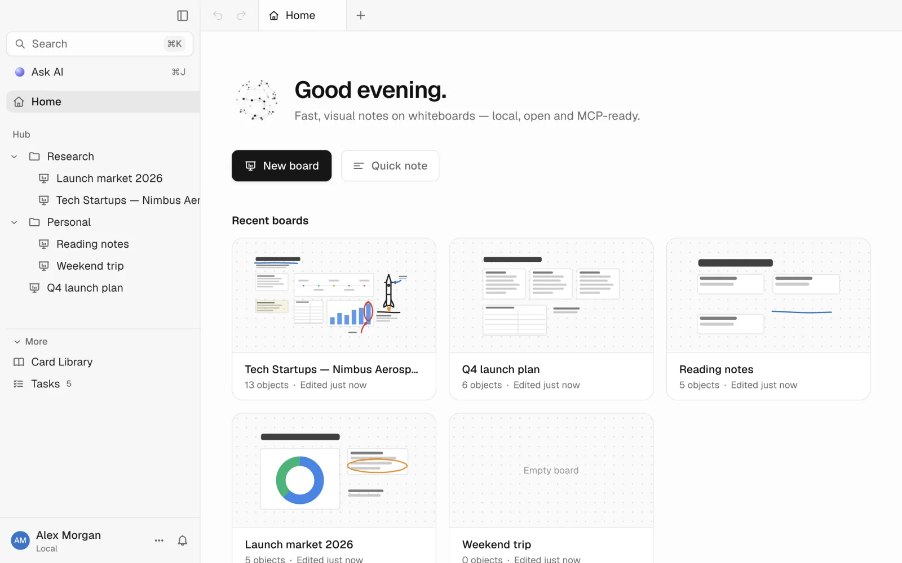

<div align="center">

<picture>
  <source media="(prefers-color-scheme: dark)" srcset="docs/logo-dark.svg">
  
</picture>

# Sidera

**Fast, visual notes on whiteboards — local, open and MCP-ready.**

[](LICENSE)


</div>

Sidera is a free, open-source, local-first app for fast, visual note-taking on whiteboards. Put text, tables,
live charts, images and hand drawings on one infinite board — and take it to your iPad — instead of splitting the
same idea across a dozen documents. Built **MCP-first**: every core action is an MCP tool, so Claude Desktop,
Claude Code or any other MCP client can read and build your boards alongside you.

<picture>
  <source media="(prefers-color-scheme: dark)" srcset="docs/screenshots/hero-dark.webp">
  
</picture>

<p align="center"><sub>Everything above is one board: text, a table, eight charts, images, sketches and pen ink — built in Sidera.</sub></p>

## On your iPad, live

Press the iPad button on any board and it opens on your iPad — both ways, in real time, over your own Wi-Fi. A finger
pans and zooms, **Apple Pencil draws**, everything else stays editable. End-to-end encrypted, no cloud, no App Store.

<table>
<tr>
<td width="50%"></td>
<td width="50%"></td>
</tr>
</table>

## Charts that live on the board

Sixteen chart types — column, bar, line, area, combo, radar, pie, donut, **waterfall**, scatter, bubble, heatmap,
sankey, timeline, 2×2 matrix and Venn — each backed by a small table you can edit in place, or **linked to a table on
the board** so it redraws whenever the numbers change. Colour by value (everything below break-even in red), labelled
markers, own axis ticks and titles, smooth or straight lines — and you can circle the bar that matters with the pen.



## Features

- **Whiteboards, first** — an infinite canvas with text boxes (plain or framed, any size), tables, charts, images &
  PDFs, colored sections, labeled connectors, mindmaps, Mermaid diagrams and link previews. Rotate anything, undo/redo,
  ⌘F find, minimap and zoom.
- **Pen mode** — sketch straight onto the board (P), with pen, highlighter, eraser, colours and widths. Ink is part of the
  board, not a layer on top.
- **Sidera for iPad** — the board live on your iPad as a home-screen web app; pair once with a QR code.
- **Cards & backlinks** — rich text (Tiptap) with `/` commands and `@` mentions that create real backlinks; one card
  can live on any number of whiteboards.
- **AI chat, bring your own key** — an in-app Claude assistant (⌘J) that uses the exact same tools as the MCP server,
  so anything an external agent can do, it can do too. Optional native web search for Anthropic and OpenAI models.
- **MCP server for every core action** — 50+ tools over local HTTP or stdio: Claude can build whole boards — tables,
  linked charts, ink, flowcharts — and search and organize your cards, tags, kanban and tasks.
- **Accounts & guest mode** — local accounts with an optional password, or a temporary guest workspace that's wiped on
  sign-out. No cloud account, ever.
- **Local-first** — everything lives in `~/Library/Application Support/Sidera/` (SQLite + imported files); Markdown
  export/import any time.

### Also included

A card library with tags, backlinks and SQLite FTS5 search (⌘K), tags-as-databases with kanban boards and lists, a
split-screen PDF reader with highlights, and a Tasks area with list/board views, priority, assignee, due dates and an
activity timeline.

## More screenshots

<table>
<tr>
<td width="50%">

**Pen mode — draw right on the board**


</td>
<td width="50%">

**Home — boards first, with live previews**


</td>
</tr>
<tr>
<td width="50%">

**AI chat, same tools as MCP**


</td>
<td width="50%">

**Connect Claude in one command**


</td>
</tr>
<tr>
<td width="50%">

**Card library & ⌘K search**


</td>
<td width="50%">

**Tasks, across every card**


</td>
</tr>
<tr>
<td width="50%">

**PDF reader with highlights**


</td>
<td width="50%">

**Guided onboarding**


</td>
</tr>
</table>

<sub>All screenshots are generated from a scripted demo workspace (fictional companies) by `node scripts/readme/shoot.mjs`.</sub>

## Install

Download the DMG for your Mac (Apple Silicon or Intel) from the [Releases](../../releases) page and drag
Sidera into Applications. The app isn't notarized yet, so on first launch either run:

```bash
xattr -cr /Applications/Sidera.app
```

or allow it under **System Settings → Privacy & Security → Open Anyway**.

You'll land on the sign-in screen — create a local account (password optional) or continue as a guest:


## Connect to Claude (MCP)

While Sidera is running, it exposes a local MCP server with all of its tools (build boards with tables, charts and
ink; search, create and organize cards, whiteboards, tags, kanban and tasks). Easiest way in: **Settings → MCP & Claude → Connect everything**, which
wires up both Claude Desktop and Claude Code. Or from a terminal:

```bash
claude mcp add --scope user --transport http sidera http://127.0.0.1:3845/mcp
```

Headless (no UI) stdio mode is also available: `Sidera --mcp-stdio`. Your data never leaves the Mac — the
server only binds to `127.0.0.1`.

**Sidera for iPad** — the iPad button in a board's top-right corner (or ⇧⌘D) shows that board live on your iPad, both
ways: edit text, cards, tables, shapes, add photos; a finger pans and zooms, Apple Pencil draws ink. Pair once with a QR
code (Share → Add to Home Screen for the full-screen app); afterwards the iPad reconnects by itself whenever you share
a board, and follows the board where you pressed the button last. Paired devices are listed (and revocable) in
Settings → iPad.

How it works: the iPad app is a second build of the desktop renderer (`vite.ipad.config.ts`), served by the Mac on your
private LAN address while an iPad is paired (it only sees a board while you share one). Every message is end-to-end encrypted (XChaCha20-Poly1305 under
per-connection keys derived from a per-device key that was handed over once via the QR code fragment) with replay
protection, and the Mac only answers a whitelist of calls scoped to the shared board (`src/main/ipad/policy.ts`).
The protocol (`src/shared/sync`) is transport-agnostic: the LAN WebSocket can later be replaced by a cloud relay
that only forwards ciphertext between device and Mac.

## Build from source

```bash
npm install
npm run dev             # electron-vite dev, HMR renderer
npm test                # vitest, runs inside Electron's Node
npm run typecheck       # tsc for the node + web projects
npm run dist            # package a distributable app
```

## Tech stack

Electron · electron-vite · React · TypeScript · Tailwind v4 · shadcn/ui · Redux Toolkit · Tiptap · SQLite
(better-sqlite3 + Drizzle, FTS5) · React Flow · dnd-kit · cmdk · Motion · MCP SDK

## Privacy

Sidera is local-first: your database and imported files live in
`~/Library/Application Support/Sidera/` and never touch a server unless you explicitly connect an AI
provider or MCP client. Accounts are local (scrypt-hashed passwords, no cloud sync); guest workspaces are
ephemeral and deleted on sign-out. Bring your own Anthropic/OpenAI API key for the in-app assistant — it's
stored encrypted with the macOS Keychain.

## License

[MIT](LICENSE)
