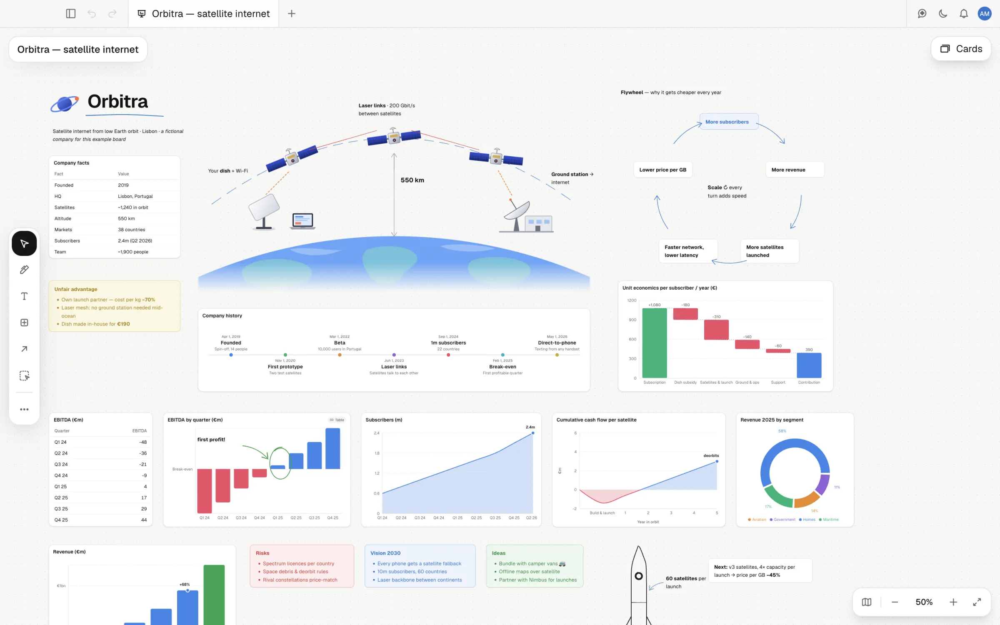
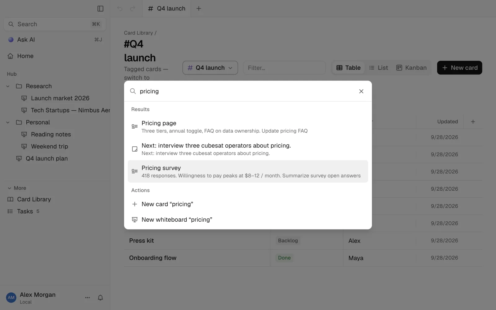
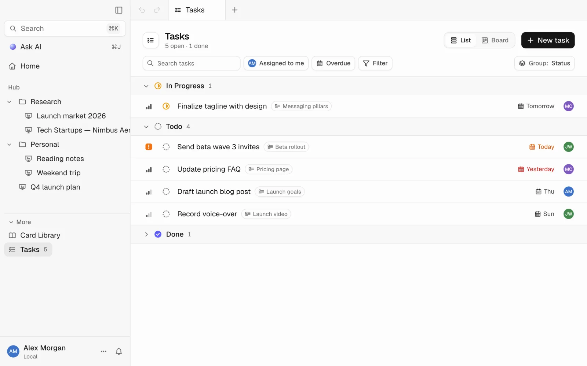
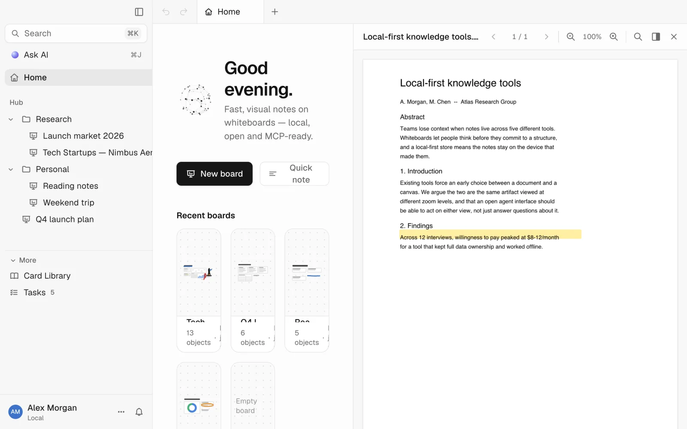
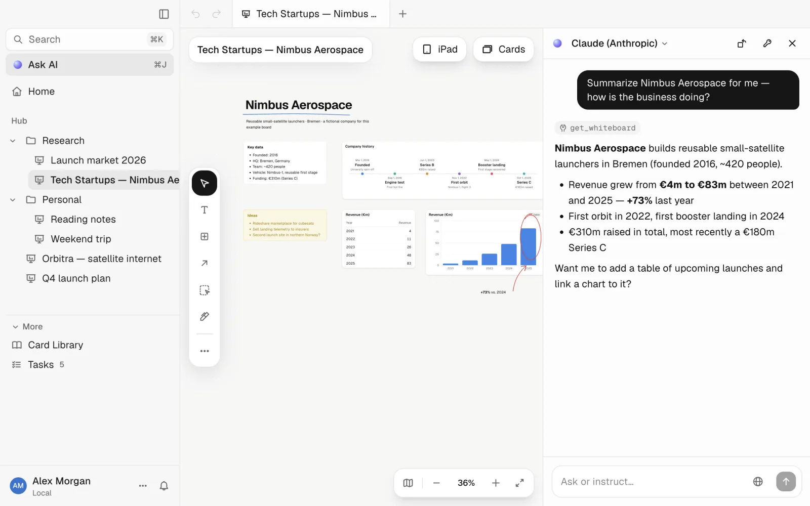
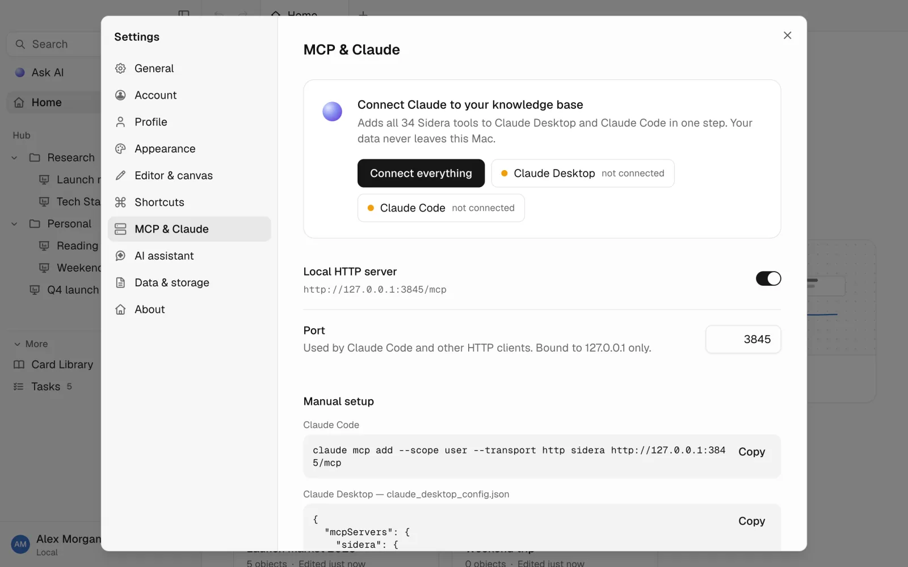
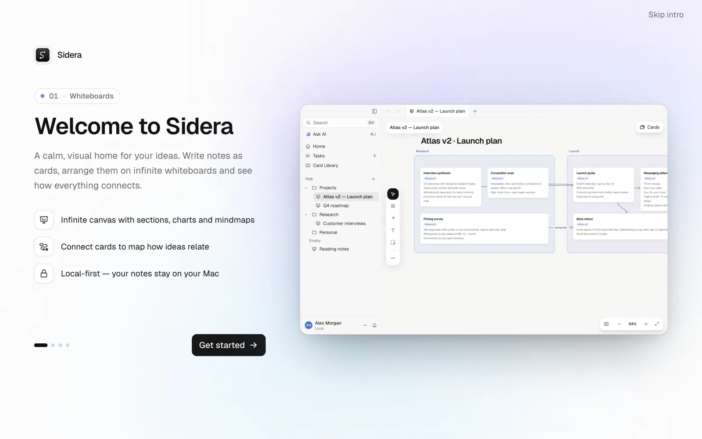
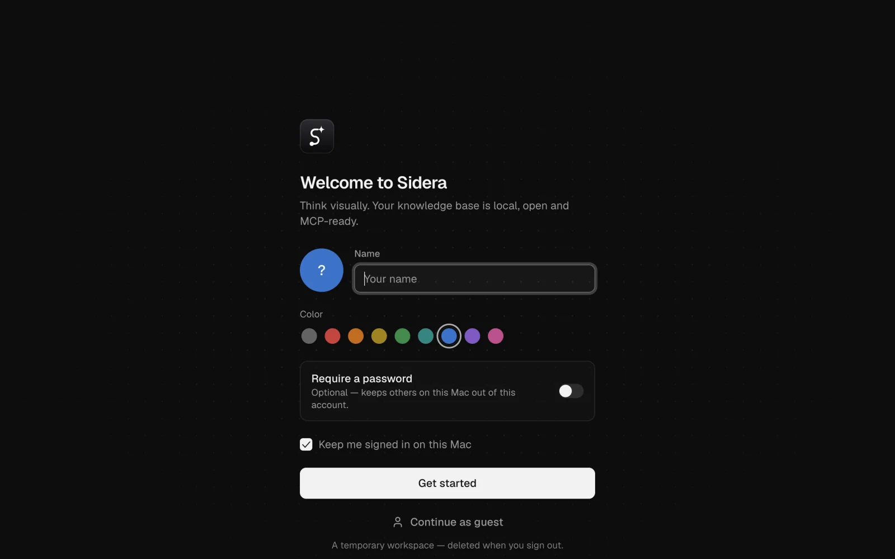

<div align="center">

<picture>
  <source media="(prefers-color-scheme: dark)" srcset="docs/logo-dark.svg">
  
</picture>

# Sidera

**Think visually. Your knowledge base is local, open and MCP-ready.**

[](LICENSE)


</div>

Sidera is a free, open-source, local-first visual knowledge base — whiteboards, a card
library with backlinks and tags, kanban boards and tasks — built **MCP-first**: every core action is exposed
as an MCP tool, so Claude Desktop, Claude Code or any other MCP client can read and organize your knowledge
alongside you.

<picture>
  <source media="(prefers-color-scheme: dark)" srcset="docs/screenshots/hero-dark.webp">
  
</picture>

## Features

- **Whiteboards** — an infinite canvas (React Flow) with cards, colored sections, labeled connections,
  mindmaps, Mermaid diagrams, charts, Excalidraw sketches, and imported PDFs & images. Undo/redo, ⌘F find,
  minimap and zoom.
- **Cards & backlinks** — rich text (Tiptap) with `/` commands and `@` mentions that create real backlinks;
  one card can live on any number of whiteboards.
- **Tags as databases** — tag a card and its tag becomes a table with typed properties, a kanban board, or a
  list.
- **Tasks** — checkboxes on any card, collected into a Tasks area with list/board views, priority, assignee,
  due dates, filters and an activity timeline.
- **Card library & search** — SQLite FTS5 search across every card and whiteboard, with instant results in
  ⌘K.
- **PDF reader** — select text in an imported PDF, save it as a colored highlight, and turn it into a quote
  card linked back to the source page.
- **AI chat, bring your own key** — an in-app Claude assistant (⌘J) that uses the exact same tools as the MCP
  server, so anything an external agent can do, it can do too. Optional native web search for Anthropic and
  OpenAI models.
- **MCP server for every core action** — 34 tools over local HTTP or stdio, so Claude Desktop and Claude Code
  can search, create and organize your whiteboards, cards, tags, kanban and tasks.
- **Accounts & guest mode** — local accounts with an optional password, or a temporary guest workspace that's
  wiped on sign-out. No cloud account, ever.
- **Guided onboarding** — welcome slides and a spotlight tour to get to a first whiteboard in under two
  minutes.
- **Local-first** — everything lives in `~/Library/Application Support/Sidera/` (SQLite + imported files);
  Markdown export/import any time.

## Screenshots

<table>
<tr>
<td width="50%">

**Card library & ⌘K search**


</td>
<td width="50%">

**Tasks, across every card**


</td>
</tr>
<tr>
<td width="50%">

**PDF reader with highlights**


</td>
<td width="50%">

**AI chat, same tools as MCP**


</td>
</tr>
<tr>
<td width="50%">

**Connect Claude in one command**


</td>
<td width="50%">

**Guided onboarding**


</td>
</tr>
</table>

## Install

Download the DMG for your Mac (Apple Silicon or Intel) from the [Releases](../../releases) page and drag
Sidera into Applications. The app isn't notarized yet, so on first launch either run:

```bash
xattr -cr /Applications/Sidera.app
```

or allow it under **System Settings → Privacy & Security → Open Anyway**.

You'll land on the sign-in screen — create a local account (password optional) or continue as a guest:



## Connect to Claude (MCP)

While Sidera is running, it exposes a local MCP server with all 34 tools (search, create and organize cards,
whiteboards, tags, kanban and tasks). Easiest way in: **Settings → MCP & Claude → Connect everything**, which
wires up both Claude Desktop and Claude Code. Or from a terminal:

```bash
claude mcp add --scope user --transport http sidera http://127.0.0.1:3845/mcp
```

Headless (no UI) stdio mode is also available: `Sidera --mcp-stdio`. Your data never leaves the Mac — the
server only binds to `127.0.0.1`.

**Draw on iPad** (whiteboard menu or ⇧⌘D) shows a QR code that opens a small drawing page on your iPad over the local
Wi-Fi. Strokes arrive as an editable sketch. That connection is end-to-end encrypted (XChaCha20-Poly1305, key only in
the QR code), bound to your private LAN address and open only while the dialog waits for the drawing.

## Build from source

```bash
npm install
npm run dev             # electron-vite dev, HMR renderer
npm test                # vitest, runs inside Electron's Node
npm run typecheck       # tsc for the node + web projects
npm run dist            # package a distributable app
```

## Tech stack

Electron · electron-vite · React · TypeScript · Tailwind v4 · shadcn/ui · Redux Toolkit · Tiptap · SQLite
(better-sqlite3 + Drizzle, FTS5) · React Flow · dnd-kit · cmdk · Motion · MCP SDK

## Privacy

Sidera is local-first: your database and imported files live in
`~/Library/Application Support/Sidera/` and never touch a server unless you explicitly connect an AI
provider or MCP client. Accounts are local (scrypt-hashed passwords, no cloud sync); guest workspaces are
ephemeral and deleted on sign-out. Bring your own Anthropic/OpenAI API key for the in-app assistant — it's
stored encrypted with the macOS Keychain.

## License

[MIT](LICENSE)
