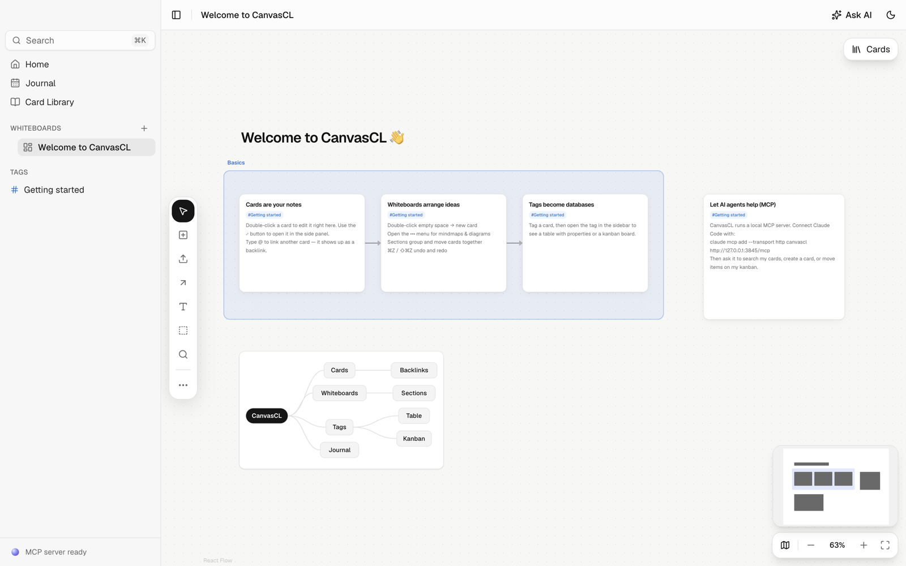

# CanvasCL

A free, open-source, local-first visual knowledge base — whiteboards, a card library with backlinks & tags, kanban/table/list views, a daily journal — and **MCP-first**: every core action is exposed as an MCP tool so AI agents (Claude Desktop, Claude Code, …) can read and organize your knowledge.



## Features
- **Whiteboards** — infinite canvas (React Flow) with a floating tool bar: cards, text, colored sections, arrows with labels, nested whiteboards, mindmaps, Mermaid diagrams, Excalidraw sketches, PDFs & images. Undo/redo, copy/paste, ⌘F find, minimap & zoom controls.
- **Cards** — rich text (Tiptap) with `/` commands, `@` links and backlinks; edit inline on the canvas or in the side panel; one card can live on many whiteboards.
- **PDF reading** — select text in a PDF and turn it into a quote card linked to the source.
- **Tags as databases** — table view with typed properties, kanban boards (drag & drop), list view.
- **Journal** — one card per day.
- **Search** — SQLite FTS5 across cards and whiteboards (⌘K).
- **MCP-first** — local MCP server (HTTP + stdio) with 19 tools, live activity feed, and a built-in Claude assistant that uses the same tools.
- **Tabs & settings** — open several whiteboards in tabs (⌘T, ⌘-click); settings for theme, font (Jost/Futura/Geist/SF), editor, MCP and fully rebindable shortcuts (⌘,).
- **Local-first** — everything lives in `~/Library/Application Support/CanvasCL/data/` (SQLite database + imported files); Markdown export/import.

## Stack
Electron · electron-vite · React · TypeScript · Tailwind v4 · shadcn/ui · Redux Toolkit · Tiptap · SQLite (better-sqlite3 + Drizzle, FTS5) · React Flow · dnd-kit · cmdk · Motion · MCP SDK

## Develop
```bash
npm install
npm run dev
npm test && npm run typecheck
```

## MCP
Easiest: **Settings → MCP & Claude → Connect everything** (adds CanvasCL to Claude Desktop and Claude Code). While the app runs, an MCP server listens on `http://127.0.0.1:3845/mcp` (Streamable HTTP).
Headless stdio mode: `CanvasCL --mcp-stdio`. Tools: `search_cards`, `get_card`, `create_card`, `update_card`, `clip_url`,
`list_cards`, `list_tags`, `tag_card`, `create_property`, `set_card_property`, `list_whiteboards`, `get_whiteboard`, `create_whiteboard`, `add_card_to_whiteboard`,
`add_section`, `organize_board`, `add_chart`, `update_chart`, `add_mindmap`, `add_flowchart`, `update_diagram`, `connect_objects`, `get_kanban`, `move_kanban_item`, `get_journal`, `append_to_journal`, `list_tasks`, `complete_task`. Also exposes an
`organize-board` prompt that guides an agent through grouping a whiteboard's objects and calling `organize_board`.

## In-app assistant
Press **⌘J** (or *Ask AI*) for a chat panel powered by Claude (`claude-opus-5`, adaptive thinking, server-side refusal fallback). It uses **the same tools as the MCP server** via an in-process MCP client, so everything an external agent can do, the built-in assistant can do too. Bring your own Anthropic API key — it's stored encrypted with the macOS Keychain (`safeStorage`), or read from `ANTHROPIC_API_KEY`.

## Data ownership
⌘K → *Export all cards as Markdown* writes one `.md` file per card (front matter with id/tags) plus a `journal/` folder. *Import Markdown files* does the reverse.

## License
MIT
